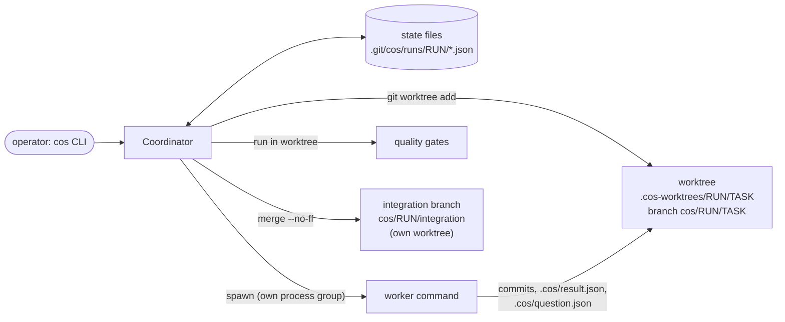
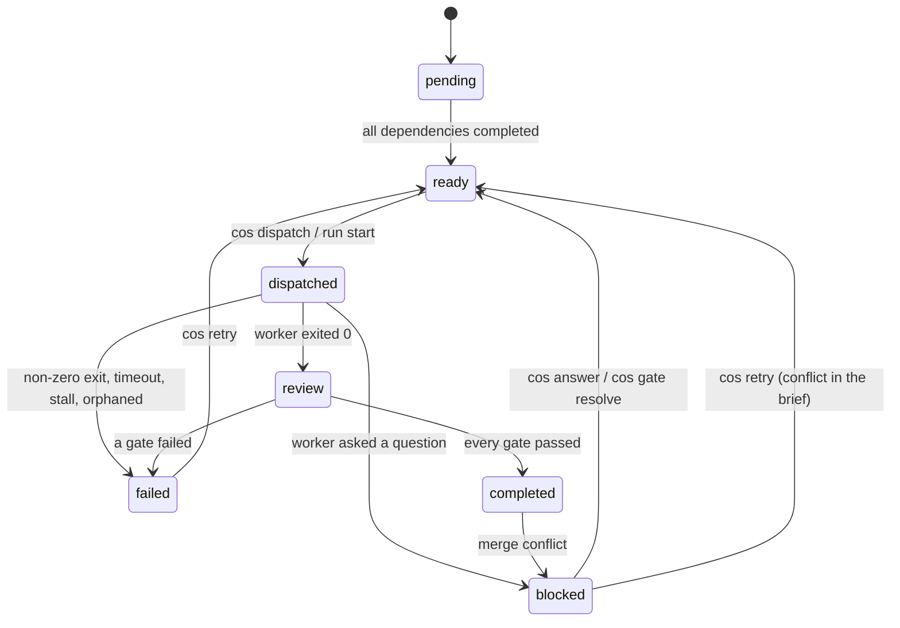

# chief-of-staff

A small local coordinator for coding agents: one "chief of staff" splits an objective into a task DAG and
hands each task to a worker (any command you configure) in its own git worktree. Workers can ask questions,
the coordinator can put decision gates in front of tasks, and a task only counts as done after your quality
gates (tests, linter, `refcheck check --json`, ...) pass. Everything is plain JSON files plus git branches.

```text
cos plan plan.yaml  ->  cos run start  ->  worker per task, in .cos-worktrees/<run>/<task>
                                       ->  gates (exit code or refcheck JSON)  ->  completed
                                       ->  merge --no-ff into cos/<run>/integration
```

## Why

Running several coding agents against one checkout goes wrong in predictable ways. They overwrite each other's
files, and each one reports "done" without anything checking it. A question an agent has is lost in a terminal
scrollback, and when the machine or the terminal dies nobody knows which task was half finished. `cos` makes
those things explicit and inspectable:

- every task gets its own worktree and branch, so parallel edits cannot collide before a deliberate merge;
- "done" means the configured gates passed, and a failed gate is attached to the task and fed back into the next attempt's brief;
- questions and escalations land in a per-run inbox instead of a terminal;
- every dispatch is a JSON file with the supervisor's pid, so a crashed run is detected and can be retried;
- your own working tree and branch are never touched.

It does not make agents smarter and it does not sandbox them. See [Limitations](#limitations).

## Install

From source (Node 20 or newer, git 2.17+; macOS or Linux):

```bash
git clone <this repository> chief-of-staff && cd chief-of-staff
npm install && npm run build
node dist/cli.js --help          # or `npm link` to get a `cos` command
```

The package name is `chief-of-staff` and the binary is `cos`. The only runtime dependency is `yaml` (plan files).

## Architecture



Task lifecycle:



Concepts:

| Concept | What it is |
| --- | --- |
| **Run** | Durable namespace for one objective. Owns an integration branch `cos/<run>/integration` created at the base commit. |
| **Task** | Spec, acceptance notes, dependencies (a DAG, cycles are rejected) and a status: `pending`, `ready`, `dispatched`, `review`, `completed`, `failed`, `blocked`. |
| **Dispatch** | One attempt at a task: a worktree, a brief, a worker process, gate results. Task `a` can have `d1`, `d4`, ... |
| **Message** | Entries in the run's inbox: `status`, `question`, `escalation`, `worker_done`. |
| **Decision gate** | A coordinator-owned question that blocks a task until `cos gate resolve`. |
| **Quality gate** | Commands run in the worktree after the worker finished; all must pass. |

Where things live (all inspectable with `cat`/`ls`):

```text
<repo>/.git/cos/runs/<run>/run.json
                        /tasks/<task>.json
                        /dispatches/<dispatch>.json      status, pid, supervisor pid, exit code, gate results
                        /dispatches/<dispatch>.brief.md  the exact brief the worker received
                        /messages/<message>.json
                        /decisions/<gate>.json
                        /logs/<dispatch>.log             worker stdout+stderr; gate logs next to it
<repo>/.cos-worktrees/<run>/<task>/                      worktree, branch cos/<run>/<task>
<repo>/.cos-worktrees/<run>/_integration/                worktree of the integration branch (merges happen here)
<worktree>/.cos/brief.md, task.json, result.json, question.json, answer.json, heartbeat
```

State writes are atomic (temp file + rename) and read-modify-write sequences hold a per-run lock directory
whose owner pid is checked, so a lock left by a dead process is stolen. I chose plain JSON files over
`node:sqlite`: it is still experimental (prints a warning on Node 22) and does not exist on Node 20.

## The worker contract

A worker is any command. It runs with the worktree as its working directory, in its own process group,
with stdout and stderr appended to `logs/<dispatch>.log`.

- **Input**: `.cos/brief.md` (objective, task spec, acceptance criteria, gate commands, completed dependencies,
  answers to earlier questions, decisions, the previous failure on a retry, merge conflicts) and the structured
  copy `.cos/task.json`. The path is passed through the `{briefPath}` placeholder and `COS_BRIEF`.
- **Output**: the exit code (0 = done) and optionally `.cos/result.json`:
  `{"outcome": "success" | "failure", "summary": "...", "filesModified": ["..."]}`.
  Exit 0 with `"outcome": "failure"` counts as failed; a non-zero exit always counts as failed.
  Commit your work. Anything left uncommitted is committed for you (`cos: uncommitted changes from task ...`).
- **Questions**: write `.cos/question.json` (`{"question": "...", "options": ["..."]}`). Either exit 0 without a
  result and you are re-dispatched with the answer in the brief (the task is `blocked` meanwhile), or keep running and
  poll `.cos/answer.json` (`{"messageId", "question", "answer"}`), which `cos answer` writes while you run.
- **Heartbeat** (optional): touch `.cos/heartbeat`. If the worker config sets `heartbeatTimeoutSec` and the file exists
  but its mtime is older than that, the worker is killed as `stalled`. No heartbeat file, no enforcement.
- **Environment**: only an allowlist from the parent (`PATH HOME USER LOGNAME SHELL LANG LC_ALL LC_CTYPE TERM TMPDIR TZ`
  plus `envAllow` from the config), then the worker's `env` from the config (placeholders expanded), then
  `COS_RUN COS_TASK COS_DISPATCH COS_BRIEF COS_WORKTREE COS_REPO`. Anything else in your shell (tokens, cloud credentials) is not passed.
- **Timeouts**: after `timeoutSec` the whole process group gets SIGTERM, then SIGKILL after `killGraceSec`.
  When the worker exits, leftover members of its process group are killed too.

## Configuration: `cos.config.json`

Read from the repository root (or `--config <path>`) every time a task is dispatched, so edits apply to the next dispatch.

```json
{
  "workers": {
    "default": {
      "command": "node",
      "args": ["/path/to/chief-of-staff/examples/fake-worker.mjs", "{briefPath}"],
      "env": { "FAKE_WORKER": "1" },
      "timeoutSec": 300
    }
  },
  "gates": [
    {
      "name": "no-todo",
      "command": "! grep -rn TODO --exclude-dir=.git --exclude-dir=.cos ."
    }
  ],
  "concurrency": 2
}
```

| Key | Meaning | Default |
| --- | --- | --- |
| `workers.<name>.command` | executable to run | required |
| `workers.<name>.args` | argument list; placeholders are expanded. **If omitted, `command` is run through `/bin/sh -c`.** | shell mode |
| `workers.<name>.env` | extra environment (placeholders expanded) | `{}` |
| `workers.<name>.timeoutSec` | wall-clock limit | `1800` |
| `workers.<name>.heartbeatTimeoutSec` | stall limit once `.cos/heartbeat` exists | off |
| `gates[].name` | unique gate name | required |
| `gates[].command`, `args`, `env` | same rules as workers; run with the worktree as cwd | required |
| `gates[].timeoutSec` | wall-clock limit | `600` |
| `gates[].format` | `"exit"` (exit code 0 passes) or `"refcheck-json"` | `"exit"` |
| `concurrency` | default for `run start --concurrency` | `2` |
| `envAllow` | extra variable names to pass through from the parent environment | `[]` |
| `killGraceSec` | SIGTERM to SIGKILL delay | `2` |

Placeholders (workers and gates): `{briefPath}` `{taskId}` `{dispatchId}` `{worktree}` `{repo}` `{runId}`.
A task can pick a worker with `worker: <name>` (plan file or `--worker`); the default is `default`.

**Gates.** After a worker finishes with success, every gate runs in the worktree, in order, and all are evaluated.
The task moves `dispatched -> review -> completed` only if all pass. If any fails, the task is `failed`, the
gate's exit code and output tail (16 KB) are stored on the dispatch, and `cos retry` re-dispatches into the same
worktree with a "Previous attempt failed" section in the brief that contains that output.

With `"format": "refcheck-json"` the gate's stdout is parsed as

```json
{"version":1,"root":"...","filesChecked":3,"findings":[{"rule":"...","severity":"error","file":"...","line":1,"column":1,"message":"..."}],"summary":{"errors":0,"warnings":0}}
```

and fails on `summary.errors > 0`, on output that is not that JSON, or on exit code 2 (usage/internal error).
Warnings do not fail the gate. chief-of-staff does not import or depend on refcheck; it only runs the command you
configure, for example `{"name": "refs", "command": "refcheck", "args": ["check", "--json", "--root", "{worktree}"], "format": "refcheck-json"}`.
This parser is tested against fixtures of that JSON shape, not against a real refcheck binary.

## Plan files

```yaml
objective: Add a users table, an API on top of it, a login page and the docs
tasks:
  - id: schema
    title: Create the users table
    spec: |
      Create db/schema.sql with the users table.
      fake.write: db/schema.sql = CREATE TABLE users (id integer primary key, email text);
    acceptance:
      - db/schema.sql exists

  - id: api
    title: Add the users API
    after: schema
    spec: |
      Implement the API on top of the schema.
      fake.ask: Which auth scheme should the API use? (session or token)
      fake.write: api/users.txt = GET /users

  - id: ui
    title: Build the login page
    after: schema
    spec: |
      Build the login page.
      fake.write: ui/login.txt = TODO: wire up login
      fake.fix-on-retry: ui/login.txt = login wired to the API

  - id: docs
    title: Write the docs
    after: [api, ui]
    gate: Publish the docs under /docs or /wiki?
    spec: Document the API and the login page.
```

`cos plan plan.yaml --id demo` creates a run from `objective` (or adds the tasks to `--run <id>`). The whole plan is
validated first (duplicate ids, unknown dependencies, self dependencies, cycles); nothing is stored if any check fails.
`after` takes one id or a list. `gate:` opens a decision gate on the task before it can run.

## Demo with the fake worker

`examples/fake-worker.mjs` is a deterministic stand-in for a real agent: it reads the brief, writes a file,
commits it, and writes `.cos/result.json`. Directive lines inside the task spec (`fake.write`, `fake.ask`,
`fake.fix-on-retry`, `fake.fail`, `fake.sleep`, `fake.hang`, ...) make it fail, ask a question or misbehave; the list is at the top of the file.
`examples/demo.sh` builds a throwaway repository and drives the four-task plan above:

```bash
npm install && npm run build
bash examples/demo.sh            # fresh temp repo; or: bash examples/demo.sh /tmp/my-demo
```

What happens: `schema` completes. `api` asks which auth scheme to use and blocks. `ui` leaves a `TODO` in its output,
so the `no-todo` gate fails. `docs` is behind a decision gate. The operator answers the question, retries `ui`
(the brief now carries the grep output), resolves the gate, and a second `run start` finishes `api` and `docs`
and merges everything into `cos/demo/integration`. This is the real output of that script (commit hashes and the temporary
directory differ per run; otherwise it is identical between runs; I diffed two runs with hashes masked):

```text
$ cos plan plan.yaml --id demo
created run demo (integration branch cos/demo/integration)
loaded 4 task(s) into run demo

$ cos status
Run demo: Add a users table, an API on top of it, a login page and the docs
  base main@c166c88, integration branch cos/demo/integration
  4 task(s): 2 pending, 1 ready, 1 blocked

  level 0 (no dependencies)
    schema  ready       Create the users table

  level 1
    api     pending     Add the users API
                        after: schema
    ui      pending     Build the login page
                        after: schema

  level 2
    docs    blocked     Write the docs
                        after: api, ui
                        blocked on decision g1: Publish the docs under /docs or /wiki?

$ cos run start --concurrency 1
  dispatch d1: task schema (attempt 1) started on cos/demo/schema
  dispatch d1: task schema completed
  merged dependency schema into cos/demo/integration
  dispatch d2: task api (attempt 1) started on cos/demo/api
  dispatch d2: task api asks m5: Which auth scheme should the API use? (session or token)
  dispatch d2: task api is waiting for an answer
  dispatch d3: task ui (attempt 1) started on cos/demo/ui
  dispatch d3: task ui failed: quality gate failed: no-todo (exit 1)
run demo: 1 completed, 1 failed, 2 blocked (3 dispatch(es) started)
needs attention:
  api [blocked] question: Which auth scheme should the API use? (session or token)
  ui [failed] quality gate failed: no-todo (exit 1)
  docs [blocked] decision: Publish the docs under /docs or /wiki?
run is not complete

$ cos inbox --type question
m5  question task=api dispatch=d2  from worker:d2 [unanswered]
    Which auth scheme should the API use? (session or token)

$ cos inbox --type escalation
m8  escalation task=ui dispatch=d3  from coordinator
    task ui failed (attempt 1): quality gate failed: no-todo (exit 1). Use "cos retry --task ui" to re-dispatch with the failure appended to the brief.

$ cos task show --task ui
task ui: Build the login page
  status: failed
  after: schema
  attempts: 1
  spec:
    Build the login page.
    fake.write: ui/login.txt = TODO: wire up login
    fake.fix-on-retry: ui/login.txt = login wired to the API
  summary: Build the login page (2 file(s))
  failure: quality gate failed: no-todo (exit 1)
  d3 (attempt 1): failed, exit 0
    quality gate failed: no-todo (exit 1)
    gate no-todo: FAILED (exit 1)
      | ./ui/login.txt:1:TODO: wire up login

$ cos answer --message m5 --text token
answered m5; task api can continue

$ cos retry --task ui
  dispatch d4: task ui (attempt 2) started on cos/demo/ui
  dispatch d4: task ui completed
dispatch d4 for task ui: passed (attempt 2)
  gate no-todo: passed (exit 0)

$ cos gate list
g1  task=docs  [open]  Publish the docs under /docs or /wiki?

$ cos gate resolve --gate g1 --decision /docs
resolved g1: /docs

$ cos run start --concurrency 1
  dispatch d5: task api (attempt 2) started on cos/demo/api
  dispatch d5: task api completed
  merged dependency api into cos/demo/integration
  merged dependency ui into cos/demo/integration
  dispatch d6: task docs (attempt 1) started on cos/demo/docs
  dispatch d6: task docs completed
run demo: 4 completed (2 dispatch(es) started)
  merged docs
all tasks completed and merged into the integration branch

$ cos status
Run demo: Add a users table, an API on top of it, a login page and the docs
  base main@c166c88, integration branch cos/demo/integration
  4 task(s): 4 completed

  level 0 (no dependencies)
    schema  completed   Create the users table  (merged)

  level 1
    api     completed   Add the users API  (merged, attempt 2)
                        after: schema
    ui      completed   Build the login page  (merged, attempt 2)
                        after: schema

  level 2
    docs    completed   Write the docs  (merged)
                        after: api, ui

$ git log --oneline --graph cos/demo/integration
*   205f546 Merge task docs: Write the docs
|\  
| * 0728ad6 fake-worker: Write the docs
|/  
*   b1c171a Merge task ui: Build the login page
|\  
| * 0a34eef fake-worker: Build the login page
| * f5a7ee9 fake-worker: Build the login page
* |   dc0530d Merge task api: Add the users API
|\ \  
| |/  
|/|   
| * b64c047 fake-worker: Add the users API
|/  
*   3e2ab72 Merge task schema: Create the users table
|\  
| * feeaf22 fake-worker: Create the users table
|/  
* c166c88 initial commit

$ git show cos/demo/integration:fake-output/api.txt
task api: Add the users API
answer: Which auth scheme should the API use? (session or token) -> token

$ git show cos/demo/integration:fake-output/docs.txt
task docs: Write the docs
decision: Publish the docs under /docs or /wiki? -> /docs

$ git branch --show-current
main

$ git status --short
?? cos.config.json
?? plan.yaml

$ cos cleanup
removed demo/schema
removed demo/api
removed demo/ui
removed demo/docs
removed demo/integration
```

Your checked-out `main` is untouched: the only differences in `git status` are the two files the script created.
The integration branch is the result; merge it into your own branch when you are satisfied: `git merge cos/demo/integration`.

## Commands

```text
cos - chief of staff: run coding-agent workers on a task DAG in git worktrees

Usage: cos <command> [options]

Runs
  run create --objective <text> [--id <id>] [--base <ref>]   create a run (repo = current directory or --repo)
  run list                                                    list runs
  run start [--run <id>] [--concurrency <n>] [--retries <n>] [--no-merge] [--wait]
                                                              dispatch every ready task until nothing is runnable
  status [--run <id>] [--format text|mermaid|json]            task DAG with statuses
Tasks
  task add --title <t> --spec <s> [--id <id>] [--after <task>]... [--acceptance <a>]... [--worker <name>] [--run <id>]
  task list [--run <id>] [--json]
  task show --task <id> [--run <id>]
  plan <file.yaml|file.json> [--run <id>] [--id <new run id>]   load a whole DAG (creates a run if the plan has an objective)
Execution
  dispatch --task <id> [--worker <name>] [--run <id>]         run one attempt of a ready task
  retry --task <id> [--worker <name>] [--run <id>]            re-dispatch a failed task with the failure in the brief
  logs --task <id> [--dispatch <id>] [--run <id>]             print a worker log
  recover [--run <id>]                                        mark dispatches whose supervisor died as orphaned
Messages
  inbox [--run <id>] [--all] [--type status|question|escalation|worker_done] [--json]
  ack <message>... | --all [--run <id>]
  send --type <type> --body <text> [--task <id>] [--to <task>] [--from <label>] [--dispatch <id>] [--run <id>]
  answer --message <id> --text <answer> [--run <id>]
Decision gates
  gate open --task <id> --question <text> [--options a,b] [--run <id>]
  gate list [--all] [--run <id>]
  gate resolve --gate <id> --decision <text> [--run <id>]
Integration
  merge --task <id> | --all [--run <id>]                      merge completed task branches into the integration branch
  cleanup [--run <id>] [--task <id>] [--force] [--branches]   remove worktrees (never with uncommitted changes unless --force)

Global options: --repo <path> (default: current directory), --config <path> (default: cos.config.json), --json, --help, --version
Exit codes: 0 success, 1 work did not complete (failed/blocked/conflict), 2 usage or internal error
```

Exit codes: `0` success, `1` the work did not complete (a task failed, is blocked or conflicted; `dispatch`/`retry`
exit 1 unless the task passed its gates), `2` usage error or internal error.

Notes on behaviour that is easy to miss:

- **Dependencies are merged before dependents start.** A task's worktree is created from the integration branch. When
  you dispatch a task, its completed but unmerged dependencies are first merged into the integration branch
  (`merged dependency X into ...`), so the new worktree contains their work. A conflict there stops the dispatch.
- **`run start`** dispatches ready tasks up to `--concurrency` (counting workers started by other `cos` processes),
  returns when nothing is runnable, and then merges every completed task unless `--no-merge`. `--retries N` re-dispatches
  failed tasks up to N times; `--wait` keeps polling while tasks wait for an answer or a decision so you can answer from another terminal.
- **Merge conflicts**: `cos merge` runs `git merge --no-ff` in the integration worktree. On conflict the merge is aborted
  (the integration branch is unchanged), the task becomes `blocked` with the conflicting paths, and an escalation lands in the inbox.
  `cos retry --task X` re-dispatches the worker with the conflict described in the brief; `cos merge --task X` tries again.
- **`cos cleanup`** removes worktrees under `.cos-worktrees/` only. It skips a worktree with uncommitted changes (including
  untracked files) unless `--force`, always skips one whose worker is running, and never deletes branches unless `--branches`
  (which only deletes branches already merged into the integration branch, or all task branches with `--force`). The integration
  branch is never deleted.
- **Safety**: `cos` refuses to run outside a git repository, creates only refs and the directories above, and adds `.cos-worktrees/` and `.cos/`
  to `.git/info/exclude`. Your current branch and working tree are not modified.

## Crash recovery

Each dispatch file records the supervisor's pid (plus its start time from `ps`, to avoid pid reuse) and the worker's pid. Workers write
to log files rather than pipes and run in their own process group, so they survive a killed supervisor. Every `cos` command starts by
looking for dispatches that are `running`/`gating` whose supervisor is gone. Those are marked `orphaned`, the leftover worker
process group is stopped (only if the pid still has the recorded start time), the task becomes `failed` with an escalation message,
and `cos retry` runs it again in the same worktree. `SIGINT`/`SIGTERM`/`SIGHUP` to `cos` kill the running workers and exit 130; the next command then
marks them orphaned. Both paths are covered by tests that start the real CLI in a child process and `SIGKILL` it.

## Library use

```ts
import { Coordinator } from "chief-of-staff";

const cos = new Coordinator({ repo: "/path/to/repo" });
const run = cos.createRun({ objective: "Add a users API", id: "users" });
cos.addTask(run.id, { id: "schema", title: "Schema", spec: "Create db/schema.sql" });
const summary = await cos.start(run.id, { concurrency: 2, retries: 1 });
```

## Limitations

- **Single machine.** All state is files under `.git/cos/` guarded by directory locks; there are no remote workers and no network protocol.
- **POSIX only.** Process groups and `ps` are used for supervision and recovery; Windows is not supported. Tested on macOS (Node 22.19 and 20.20). The CI workflow
  runs the same suite on Linux with Node 20 and 22; I have not run it there.
- **No authentication or authorization.** Whoever can run `cos` in the repository can answer questions, resolve gates and run configured commands.
- **No sandbox.** The environment allowlist keeps your shell's secrets out of workers, but a worker is an ordinary process with your permissions and can read
  or write anything your user can. Gates are the same.
- **No cost, token or rate-limit accounting.** `cos` does not know what your worker command spends.
- **`cos dispatch` and `cos run start` supervise workers from the terminal process.** Ctrl-C, SIGTERM and SIGHUP (closing the terminal) kill the running workers; SIGKILL or a crash leaves them
  running until the next `cos` command marks them orphaned and stops them. Either way the tasks must be retried; there is no daemon. A retried task continues in the same worktree, it does not resume the worker's conversation.
- **Questions are detected by polling** `.cos/question.json` every 250 ms while the worker runs.
- **Dependents see dependency work only through the integration branch.** If you dispatch with merging impossible (conflict), the dependent cannot start.
- **Gates run sequentially and only after a successful worker.** Output is capped at 16 KB per gate.
- **Missing worker binaries** show up as exit code 127 on macOS (observed); a platform that reports a spawn error instead is recorded as a failed dispatch too, with different text.
- **Quality of the plan is yours.** `cos` validates the graph, not whether the tasks make sense. `refcheck-json` parsing is tested with fixtures only.
- Dev dependencies carry open advisories that I could not fix within the 30-day dependency cutoff; see [SECURITY.md](SECURITY.md).

## Development

```bash
npm install
npm run typecheck
npm test        # 112 tests; they use real git repositories in temp directories and need no network
npm run build
```

The tests spawn real worker processes (the fake worker), real `git worktree` operations, and for crash recovery the real CLI through `tsx`.

## License

MIT
